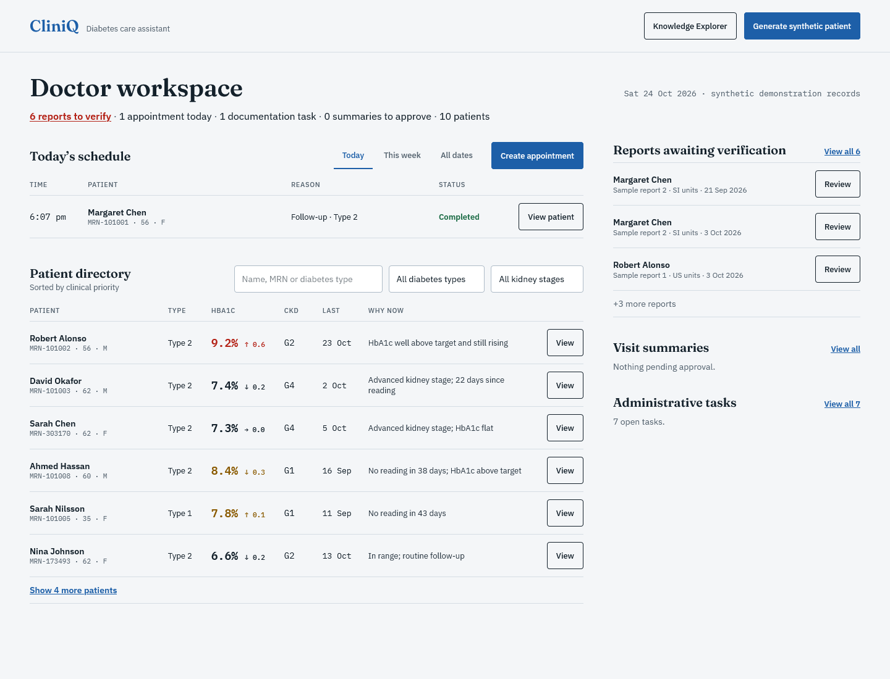
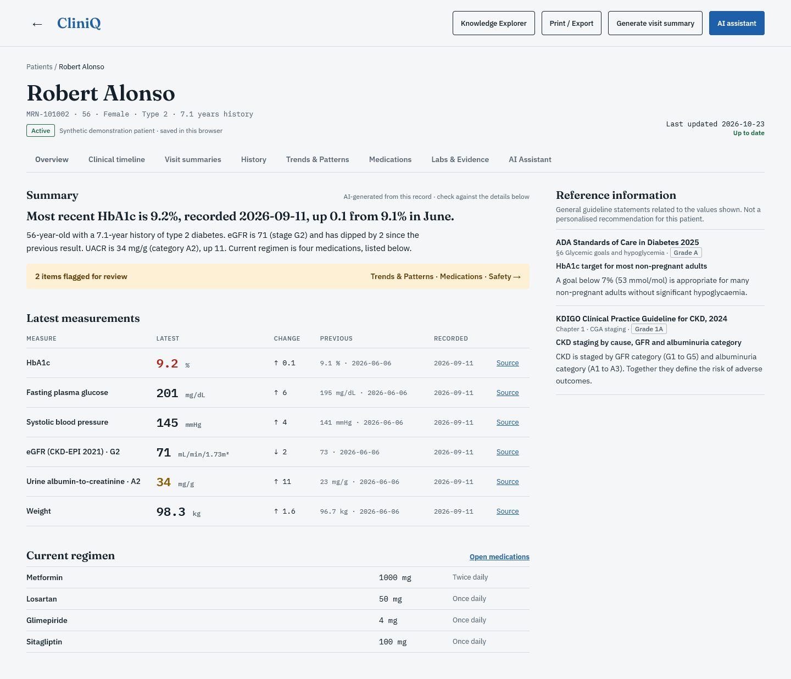
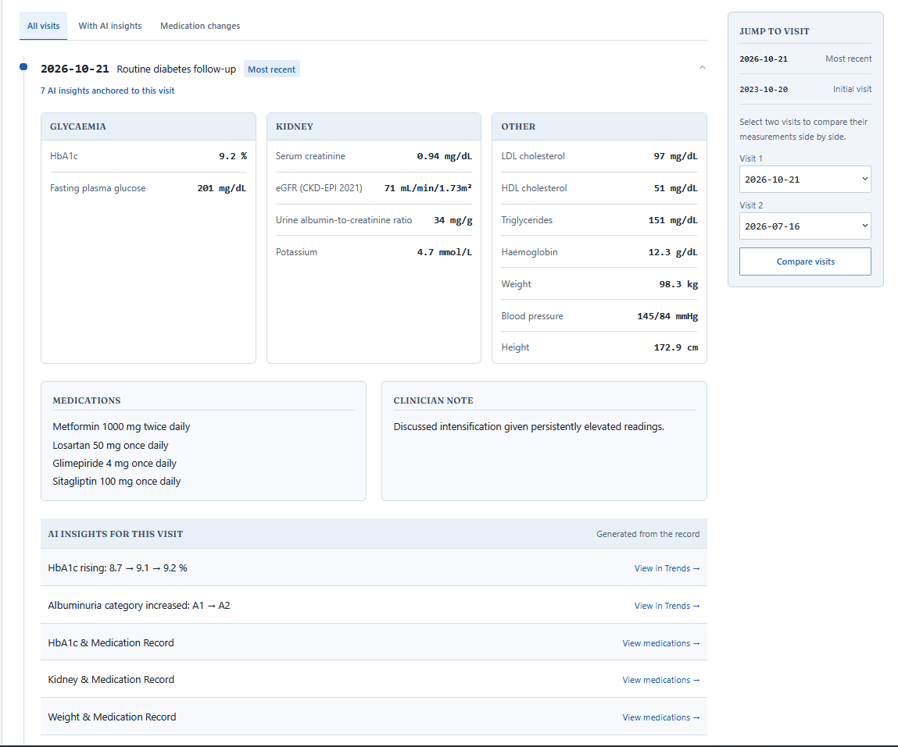
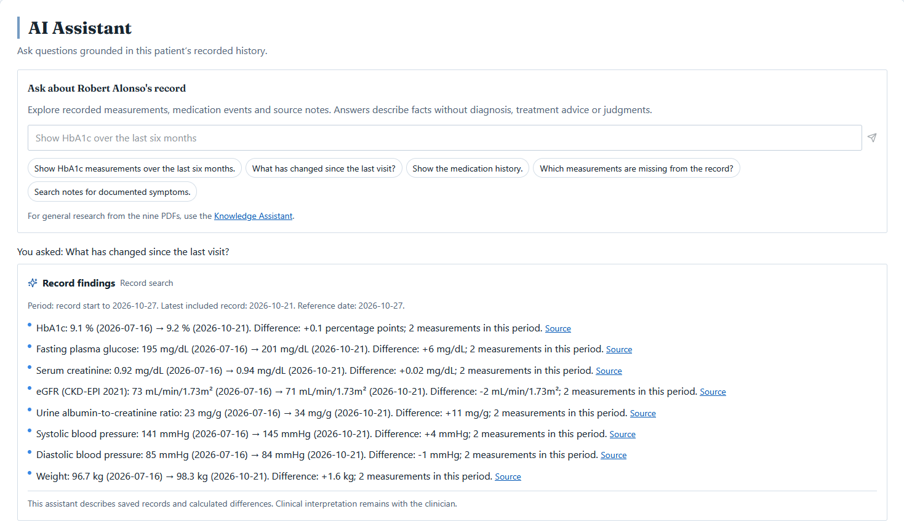
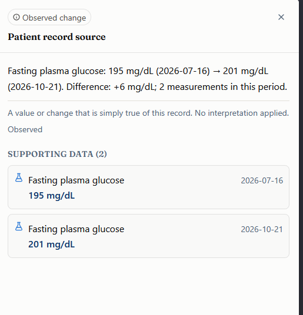
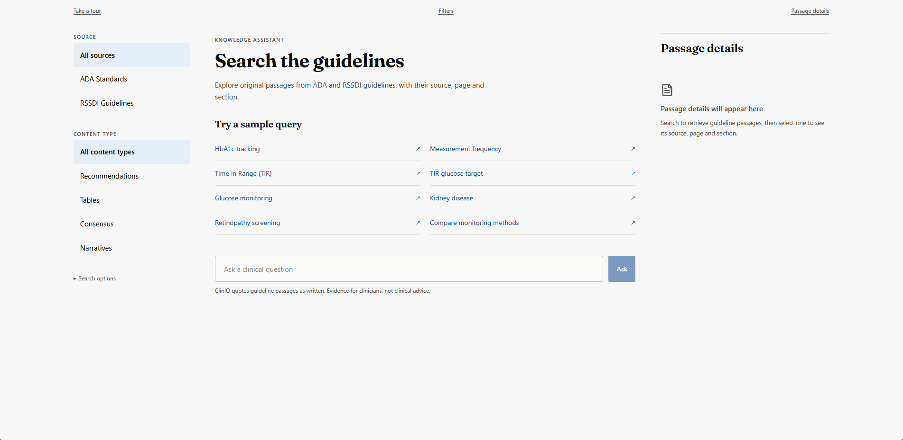
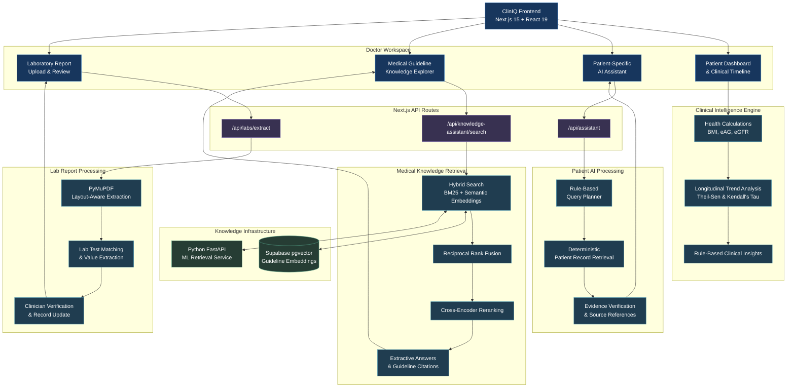

# ClinIQ — AI-Assisted Doctor Productivity & Knowledge Assistant

> **A non-diagnostic, evidence-grounded clinical decision-support and workflow workspace for longitudinal diabetes care.**  
> ClinIQ brings patient records, laboratory reports, medication timelines, documentation tools, and clinical practice guidelines into a single, unified workspace.

[](https://nextjs.org/)
[](https://react.dev/)
[](https://www.typescriptlang.org/)
[](https://tailwindcss.com/)
[](https://fastapi.tiangolo.com/)
[](https://supabase.com/)
[](https://diabetesjournals.org/care)

---

## Visual Tour & Core Interfaces

### 1. Doctor Workspace & Daily Scheduling Hub
A unified command center for morning triage, appointment tracking, pending documentation tasks, and laboratory verification queues.


---

### 2. Patient Record & Clinical Intelligence
Synthesizes multi-year patient trajectories, derived metrics (CKD-EPI 2021 eGFR, KDIGO staging, eAG, BMI), and deterministic summary narratives.


---

### 3. Unified Clinical Timeline & Visit Comparison
Interactive chronological visit timeline with glycaemic and kidney analyte grids, medication adjustments, and side-by-side delta calculations.


---

### 4. Audit-Grounded Patient AI Assistant
Read-only, deterministic query engine that extracts facts and calculated changes from verified records with zero hallucination risk.


---

### 5. Evidence Drawer & Traceable Data Provenance
Every insight, metric change, and assistant statement links back to underlying raw laboratory records, clinical notes, or guideline citations.


---

### 6. Evidence-Based Knowledge Explorer (RAG)
Hybrid vector and lexical retrieval over official ADA Standards of Care and RSSDI Expert Consensus with cross-encoder reranking and extractive synthesis.


---

## Overview

ClinIQ is engineered to address the heavy cognitive load and administrative friction clinicians face when managing patients with chronic type 1 and type 2 diabetes:

* **Siloed Records & Scattered Reports:** Synthesizes longitudinal visits, vitals, and laboratory reports into unified, interactive trend lines with statistical noise gating (Theil-Sen slope, Kendall's $\tau$).
* **Time-Consuming Documentation:** Automates visit summary generation with pre-populated vitals, lab panels, and structured draft/finalize lifecycles.
* **Complex Multi-Drug Regimens:** Maps medication start, stop, and titration events directly alongside glycaemic and renal markers.
* **Strict Non-Diagnostic Safety:** Operates as a purely assistive, non-prescriptive platform. Incorporates algorithmic causality filters that strictly eliminate speculative or unsupported causal claims.

---

## System Architecture

ClinIQ is architected around a dual-engine paradigm: a client-side deterministic clinical engine paired with an enterprise-grade multi-tiered RAG retrieval backend.


## System Architecture




---

## Core Feature Breakdown

### 1. Doctor Productivity & Workspace Management

- **Appointment Management:** Schedule and manage patient appointments with daily and weekly calendar views, conflict detection, and visit status tracking.
- **Doctor Worklist:** View pending lab reviews, upcoming appointments, documentation tasks, and draft summaries from a centralized dashboard.
- **Patient Search & Filtering:** Quickly find patients and filter records by diabetes type, kidney disease stage, and latest HbA1c levels.

### 2. Patient Records & Clinical Insights

- **Comprehensive Patient Overview:** Organizes patient history, medical conditions, medications, lab results, and vital signs in one place.
- **Automatic Health Calculations:** Calculates important health metrics such as BMI and estimated average blood glucose (eAG).
- **Health Trends & Patterns:** Tracks changes in patient health over time, using statistical analysis to identify meaningful trends while reducing the impact of unusual readings.
- **Clinical Insights:** Highlights important observations related to blood sugar, kidney health, cardiovascular health, medication history, and pending screenings for doctors to review.

### 3. Laboratory Report Upload & Extraction

- **PDF Report Upload:** Upload laboratory reports and automatically extract test names, results, reference ranges, and report dates.
- **Intelligent Data Extraction:** Recognizes different laboratory test names and abbreviations, helping organize extracted results into standardized patient records.
- **Review & Verification:** Allows doctors to review, correct, and approve extracted values before adding them to a patient's medical history.
- **Report Storage:** Preserves uploaded PDF reports in browser storage for future reference.

### 4. Clinical Documentation & Visit Summaries

- **Automated Visit Summaries:** Pre-fills visit notes with available patient information, vital signs, and laboratory results to reduce manual documentation.
- **Draft & Finalize:** Allows doctors to create, edit, save, and finalize clinical notes during or after consultations.
- **Print & Export:** Provides formatted visit summaries that can be printed or transferred to electronic health record (EHR) systems.

### 5. Dual AI Assistant System

ClinIQ features two specialized assistants designed to help doctors retrieve patient information and access reliable medical knowledge.

#### A. Patient-Specific AI Assistant

- **Natural Language Queries:** Allows doctors to ask questions about a patient's medical history, laboratory results, medications, and health trends in everyday language.
- **Patient Record Retrieval:** Retrieves relevant information directly from recorded patient data using structured queries and deterministic processing.
- **Verified Responses:** Validates retrieved information against original patient records before presenting answers, reducing the risk of unsupported information.
- **Source References:** Provides links to relevant medical records, visit dates, and reports so doctors can verify the information.
- **Intent-aware filtering:** Separates laboratories, vitals, medication prescriptions, profile history, notes, and visits; combines categories only when requested. Specific tests and recorded medication names, medication classes/statuses, calendar years, named months, exact dates, and relative periods narrow retrieval. Ambiguous or unsupported queries ask for clarification instead of returning a complete patient summary.
- **Deterministic execution:** The patient assistant uses the same rules, record filters, and evidence validation in the browser and API. It does not call an LLM, embedding service, or the Knowledge Assistant, even when model credentials are configured. Medication history describes recorded prescriptions and events, not confirmed adherence. Disappearance from a later prescription snapshot does not establish a stop date.
- **Available data:** Appointment schedules are not part of the patient schema; appointment questions state this explicitly. Profile fields are undated snapshots. Only verified reports contribute measurements or searchable report text. Reported values, units, operators, reference ranges, and source metadata are preserved; trend differences use normalized units and calculated values are marked. Note search uses token matching and a clinical synonym vocabulary; unsupported terminology is not interpreted as a diagnosis.
- **Regression checks:** `npm run test:patient-assistant` covers intent variations, category isolation, medication status/history, temporal and multi-intent queries, missing information, source validation, verification, and browser/API parity. `npm run test:patient-assistant-ui` exercises the patient-record UI against a running app (default `http://127.0.0.1:3100`).

#### B. Medical Guideline Knowledge Assistant

- **Trusted Medical Guidelines:** Provides access to diabetes-related clinical guidelines from the American Diabetes Association (ADA) and the Research Society for the Study of Diabetes in India (RSSDI).
- **AI-Powered Guideline Search:** Combines keyword search and semantic search to find relevant information from medical guidelines.
- **Relevant Answer Retrieval:** Identifies and extracts information directly related to a doctor's question instead of displaying lengthy, unrelated guideline passages.
- **Source-Linked Answers:** Displays answers supported by original guideline text, including document titles and page references.
- **Evidence-Based Information:** Retrieves information from trusted guideline documents without generating unsupported medical recommendations.

---

**Note:** ClinIQ is a non-diagnostic, clinician-support platform. It assists doctors with information retrieval, documentation, and workflow management. All clinical decisions remain the responsibility of qualified healthcare professionals.


## 📁 Repository Structure

```
├── app/                                 # Next.js App Router
│   ├── api/
│   │   ├── assistant/route.ts          # Patient assistant query planning & validation
│   │   ├── knowledge-assistant/search/ # Multi-tiered guideline search (Supabase / FastAPI)
│   │   └── labs/extract/route.ts       # Layout-aware PDF report extraction endpoint
│   ├── knowledge-assistant/page.tsx    # Standalone Medical Knowledge Explorer page
│   ├── patient/[id]/page.tsx           # Individual Patient Longitudinal Dashboard
│   ├── globals.css                     # Editorial typography & responsive layout styling
│   └── layout.tsx                      # Root layout, typography, and startup screen
├── components/
│   ├── assistant/                      # Patient Assistant panel, gates, and answer cards
│   ├── history/                        # Visit timeline & side-by-side visit comparison
│   ├── knowledge/                      # Knowledge Explorer, short answers, & tour
│   ├── labs/                           # LabCheck, PDF upload, bounding boxes, & parser
│   ├── meds/                           # Medication timeline & treatment change cards
│   ├── patient/                        # Patient directory, overview panel, & cohort dialog
│   ├── shared/                         # Evidence drawer, badges, citations, & startup screen
│   ├── tour/                           # Interactive workspace and knowledge onboarding tours
│   ├── trends/                         # Recharts trend workbench & parameter charts
│   └── workflow/                       # Appointment editor & visit summary modal
├── lib/
│   ├── assistant/                      # Query planning, deterministic tools, & proof validation
│   ├── clinical/                       # Derivations, analyzers, stats, units, & causality rules
│   ├── data/                           # Synthetic patient archetypes (8 seed patients) & generator
│   ├── knowledge/                      # Extractive answer synthesis, reranker client, & sources
│   ├── labs/                           # Free-text regex parser & unit normalizer
│   ├── dates.ts                        # Strict calendar date formatting & validation
│   ├── nav.ts                          # Dashboard navigation configuration
│   ├── store.ts                        # Zustand store with localStorage persistence
│   ├── supabase.ts                     # Supabase pgvector client & ONNX embedding pipeline
│   ├── types.ts                        # Core TypeScript domain models & interfaces
│   └── workflow.ts                     # Zod schemas for appointments and summaries
├── ml-service/                         # Python FastAPI Microservice
│   ├── app/
│   │   ├── lab_pdf.py                  # PyMuPDF coordinate-aware laboratory PDF extractor
│   │   ├── main.py                     # FastAPI application endpoints
│   │   ├── patient_records.py          # Ephemeral patient document semantic search
│   │   ├── retrieval.py                # BM25 + dense embedding + cross-encoder reranker engine
│   │   └── schemas.py                  # Pydantic schemas for search & health
│   └── data/                           # Passage index, embeddings, and metadata
├── supabase/
│   └── schema.sql                      # pgvector schema, HNSW indexes, & match_guideline_passages RPC
└── screenshots/                        # Application UI screenshots
```

---

## 🚀 Getting Started

### Prerequisites
- **Node.js**: v18.18.0 or newer (Node.js 20+ recommended)
- **npm**: v9 or newer
- **Python**: 3.10+ (optional, only required if running the local ML retrieval microservice)

---

### Quick Start

ClinIQ runs out of the box with zero external configuration. On first run, a realistic seed cohort of 8 synthetic patients (representing diverse clinical archetypes) loads automatically into browser storage.

1. **Clone the repository:**
   ```bash
   git clone https://github.com/your-username/diabetes-care-assistant.git
   cd diabetes-care-assistant
   ```

2. **Install dependencies:**
   ```bash
   npm install
   ```

3. **Start the development server:**
   ```bash
   npm run dev
   ```

4. **Open the application:**
   Navigate to [http://localhost:3000](http://localhost:3000) in your browser.

---

### Optional: Setting Up Supabase pgvector for Knowledge Explorer

To enable cloud-scale pgvector retrieval for the Knowledge Explorer:

1. Create a Supabase project with the `pgvector` extension enabled.
2. Execute the SQL schema script in [`supabase/schema.sql`](supabase/schema.sql) in your Supabase SQL Editor.
3. Configure your environment variables in `.env.local`:
   ```env
   SUPABASE_URL=https://your-project.supabase.co
   SUPABASE_ANON_KEY=your-anon-key
   # Optional: Hugging Face API token for faster remote query embeddings
   HF_TOKEN=your_hf_token
   ```

---

### Setting Up the Python ML Microservice

If you wish to run the local hybrid BM25 + Cross-Encoder reranking service and PDF layout parser:

1. **Navigate to the ML service directory:**
   ```bash
   cd ml-service
   ```

2. **Create a virtual environment:**
   ```bash
   python -m venv venv
   # On Windows:
   venv\Scripts\activate
   # On macOS/Linux:
   source venv/bin/activate
   ```

3. **Install dependencies:**
   ```bash
   pip install -r requirements.txt
   ```

4. **Launch the FastAPI service:**
   ```bash
   uvicorn app.main:app --host 127.0.0.1 --port 8000
   ```

5. **Link the Next.js app to the ML service in `.env.local`:**
   ```env
   ML_SERVICE_URL=http://127.0.0.1:8000
   ML_SERVICE_API_KEY=cliniq-knowledge-internal-key
   ```

---

## Clinical Safety & Regulatory Disclaimer

> **IMPORTANT CLINICAL NOTICE:**  
> ClinIQ is an assistive, non-diagnostic clinical productivity and knowledge-retrieval software tool. It is designed to assist qualified healthcare professionals in organizing and reviewing recorded patient history and exploring medical literature.  
> 
> * **No Automated Diagnosis:** ClinIQ does not generate diagnoses, predict disease onset, or classify clinical severity.
> * **No Treatment Decisions:** ClinIQ does not formulate treatment plans, suggest therapeutic interventions, or recommend drug dosages.
> * **Independent Clinician Responsibility:** All clinical decisions, diagnostic interpretations, and treatment strategies remain solely the professional responsibility of the treating clinician.
> * **Synthetic Data:** All patient records included by default are synthetically generated archetypes for demonstration and educational purposes.

---

