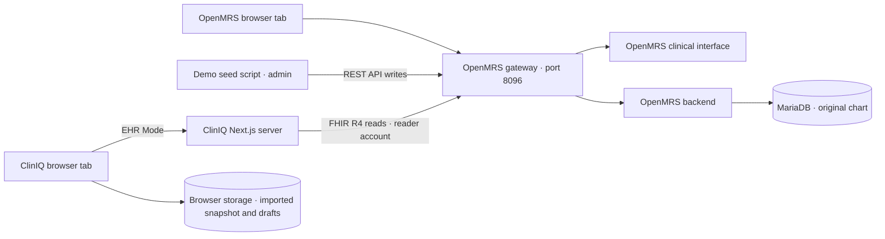

# Run the ClinIQ and OpenMRS demo locally

OpenMRS stores the original patient chart. ClinIQ reads a copy of the supported chart data and turns it into a timeline, lab comparisons, answers about the record, and a visit-summary draft. In the demo, we open the same synthetic chart in both systems.

## Where to open each app

| App | Open in your browser |
| --- | --- |
| OpenMRS | [http://127.0.0.1:8096/openmrs/spa](http://127.0.0.1:8096/openmrs/spa) to sign in and view the original patient chart. |
| ClinIQ | [http://localhost:3000](http://localhost:3000) to open the Doctor workspace and import the chart with **EHR Mode**. Use the URL printed by `npm.cmd run dev` if it selects a different port. |

Run the commands below in **Windows PowerShell**, from the repository folder that contains `package.json`.

### 1. Start OpenMRS if it is offline

Open the OpenMRS link first. If the sign-in page works, go to step 2. If OpenMRS is offline and Docker is installed inside Ubuntu WSL, run this in one PowerShell window and leave it open while you use the demo.

```powershell
wsl -d Ubuntu -u root --exec docker compose -f ehr/compose.openmrs.yml up
```

The containers run inside Ubuntu WSL. Windows can reach their gateway on port `8096`. The first startup can take several minutes while OpenMRS initializes MariaDB. Check readiness with this command in a second PowerShell window. A JSON response with `"authenticated": false` means the API is ready for sign-in.

```powershell
curl.exe -fsS http://127.0.0.1:8096/openmrs/ws/rest/v1/session
```

If Docker is already running and `docker compose version` works directly in Windows, you can start OpenMRS with `npm.cmd run ehr:start` instead. Use one startup method for the demo.

### 2. Sign in to OpenMRS

Open the OpenMRS link in your browser. A fresh local demo uses username `admin` and password `Admin123`. If the password was changed, use the current one. When prompted, pick a login location. [OpenMRS demo credentials](https://openmrs.org/demo/)

### 3. Create a synthetic chart and start ClinIQ

In the second PowerShell window, run `npm.cmd ci` if you still need to install the project dependencies. Set the three connection variables below in that same window. Choose a strong password for the separate `cliniq-reader` account and replace the placeholder. If the account already exists, use its existing password.

```powershell
$env:EHR_FHIR_BASE_URL = 'http://127.0.0.1:8096/openmrs/ws/fhir2/R4'
$env:EHR_FHIR_USERNAME = 'cliniq-reader'
$env:EHR_FHIR_PASSWORD = 'replace-with-your-reader-password'
```

On the first run, create the reader account and a synthetic patient chart. Replace `Admin123` below if your local demo uses a different administrator password. Each successful run creates another chart. Keep the `CLINIQ-SYN-...` ID printed by the command so you can find that chart in both apps.

```powershell
$env:OPENMRS_ADMIN_PASSWORD = 'Admin123'
npm.cmd run ehr:create-patient
Remove-Item Env:OPENMRS_ADMIN_PASSWORD
```

Start ClinIQ in the same PowerShell window so it receives the reader settings.

```powershell
npm.cmd run dev
```

For future sessions, set the same reader variables again before starting ClinIQ, or save the three `EHR_FHIR_*` values in `.env.local` in the repository root. You can reuse the chart already in OpenMRS and skip the seed command.

### 4. View the same chart in both apps

1. In **OpenMRS**, use patient search with the `CLINIQ-SYN-...` ID to open the source chart for **Rivera ClinIQSynthetic**.
2. In **ClinIQ**, open the **Doctor workspace**, click **EHR Mode** in the header, find that same ID, and click **Import patient**. ClinIQ reads the chart through OpenMRS's FHIR R4 API and saves a copy in the browser. The original chart stays in OpenMRS.

### Check or stop OpenMRS in WSL

Use `ps` to see the containers and `logs` to check backend startup from a separate PowerShell window.

```powershell
wsl -d Ubuntu -u root --exec docker compose -f ehr/compose.openmrs.yml ps
wsl -d Ubuntu -u root --exec docker compose -f ehr/compose.openmrs.yml logs --tail 50 backend
```

Press **Ctrl+C** in the window running Compose to stop OpenMRS. If the stack was started in the background, run the following command. The database volume keeps the charts for the next startup.

```powershell
wsl -d Ubuntu -u root --exec docker compose -f ehr/compose.openmrs.yml stop
```

## Four terms to know

| Term | Meaning in this demo |
| --- | --- |
| **EHR** | Electronic health record. Think patient chart, with demographics, diagnoses, visits, measurements, and notes. |
| **OpenMRS** | An open-source medical record system with its own clinical interface, API, and database. The demo runs its official 3.7.1 Reference Application. |
| **FHIR R4** | A standard format for exchanging health information. OpenMRS exposes data as JSON objects called resources, such as `Patient` and `Observation`. Its FHIR2 module serves the R4 API. |
| **ClinIQ** | The diabetes review workspace. It imports supported records and uses its existing tools to organize them for review and documentation. |

[OpenMRS 3.7.1 release](https://openmrs.org/openmrs-3-7-1-is-out/) · [OpenMRS FHIR2 documentation](https://fhir.openmrs.org/artifacts.html) · [HL7 FHIR R4 overview](https://hl7.org/fhir/R4/overview.html)

## What is running on the laptop?



Both startup methods use [compose.openmrs.yml](compose.openmrs.yml). Compose starts four services.

| Service | Job |
| --- | --- |
| `gateway` | Listens on `127.0.0.1:8096`. Routes the clinical interface and API requests to the right container. |
| `frontend` | Serves OpenMRS's own clinical interface at `/openmrs/spa`. |
| `backend` | Runs the OpenMRS Java application. Handles clinical requests, account permissions, and the REST and FHIR APIs. It waits for the database health check before starting. |
| `db` | Runs MariaDB. Docker named volumes preserve the database and the OpenMRS data directory between normal stops and starts. |

ClinIQ runs as a separate Next.js process. Its server speaks to OpenMRS through HTTP APIs. MariaDB is managed by OpenMRS. The demo configuration skips the bulk concept dictionary and optional drug catalogue, and disables automatic demo patients. The seed script sets up the concepts it needs. [Compose configuration](compose.openmrs.yml) · [Demo settings](openmrs-demo-settings.xml) · [OpenMRS Initializer runtime properties](https://github.com/mekomsolutions/openmrs-module-initializer/blob/main/readme/rtprops.md)

## What happens from setup to a saved draft?

1. **Create the source chart.** `npm run ehr:create-patient` uses a local OpenMRS administrator account and the OpenMRS REST API at `/openmrs/ws/rest/v1`. The script provisions a separate **ClinIQ FHIR Reader** account, creates the patient, diagnoses, visits, encounters, and observations, and publishes the `CLINIQ-SYN-…` identifier once the chart has been saved. Until then the chart has a `CLINIQ-PENDING-…` identifier. OpenMRS's clinical interface can display the seeded chart. [Seed script](seed-openmrs.mjs) · [OpenMRS REST API](https://rest.openmrs.org/)
2. **Open EHR Mode.** The ClinIQ browser requests `GET /api/ehr/patients` from its own server. The server authenticates to OpenMRS with the reader account and searches for patients with the `ClinIQSynthetic` family name. It lists matching patients with a `CLINIQ-SYN-` identifier, excluding patients explicitly marked inactive. The reader password stays on the ClinIQ server.
3. **Import the patient.** Clicking **Import patient** calls `GET /api/ehr/patients/{id}` with the OpenMRS FHIR patient ID. ClinIQ's server reads that `Patient` and then fetches their `Condition`, `Encounter`, and `Observation` results in parallel. It reads additional result pages when needed and checks that pagination stays on the configured OpenMRS origin and expected paths. It verifies patient ownership and rejects duplicate resource IDs within each clinical resource type. [FHIR client](../lib/ehr/client.ts) · [FHIR schemas](../lib/ehr/fhir.ts)
4. **Map the chart to the workspace.** The mapper uses coded diagnoses for the diabetes type and onset date. It converts eligible dated encounters into timeline visits and matches supported measurements and text notes to an encounter and date. For the lab comparison screen it groups measurements by encounter, while retaining each value's original FHIR Observation ID. [Patient mapper](../lib/ehr/map-patient.ts)
5. **Review and save locally.** The browser saves the mapped record in the existing ClinIQ workspace. The patient assistant sends a snapshot of that record and the question to ClinIQ's own server, where rule-based queries retrieve and validate facts. The visit summary prefills selected historical information, and **Save draft** stores the draft in the same browser. OpenMRS receives reads only from ClinIQ. [Patient assistant](../lib/assistant/server.ts) · [Summary builder](../lib/workflow.ts) · [Workspace storage](../lib/store.ts)

## What comes across?

| FHIR resource | What ClinIQ uses it for |
| --- | --- |
| `Patient` | Display name, demo identifier, full birth date, and a recorded male or female value. The mapper uses the FHIR birth-sex extension when it contains a supported value, with the recorded demographic value as a fallback. |
| `Condition` | An existing confirmed type 1 or type 2 diabetes diagnosis with a valid onset date and a recognized ICD-10 or SNOMED CT code. Supported active hypertension and dyslipidemia codes can also carry over. |
| `Encounter` | Dated clinical encounters become timeline entries. OpenMRS can also expose parent visits as FHIR Encounters. The connector requests the tagged clinical encounters to avoid doubling the timeline. |
| `Observation` | Selected LOINC-coded measurements and encounter notes. Supported labs include HbA1c, fasting glucose, creatinine, LDL, and urine albumin-to-creatinine ratio. Supported vitals include weight, height, heart rate, and blood pressure. |

Visits and measurements can be absent. For measurements, the mapper accepts final, amended, or corrected observations with supported units and a matching encounter and date. Conflicting values for the same measure in one encounter are left out. The workspace can show an omission count for recognized results it could not place. Medications, allergies, and arbitrary documents are outside the connector's current import scope. [Patient mapper](../lib/ehr/map-patient.ts)

## Where does the data come from, and what happens when it changes?

- **Traceability.** The imported chart shows its OpenMRS endpoint, FHIR Patient ID, and import date. ClinIQ also keeps source condition, encounter, and observation IDs so it can trace the evidence behind imported values. A lab group is built from OpenMRS observations for the ClinIQ comparison view.
- **Identity.** The source endpoint and logical FHIR Patient ID together identify the record. ClinIQ derives a stable local ID from that pair and checks the browser store before adding the chart. Two servers can issue the same logical ID. The source endpoint keeps those identities distinct.
- **Snapshots.** **Open imported record** opens the saved copy. **Refresh EHR patients** reloads the directory. Changes made later in OpenMRS stay on the source chart, and EHR Mode currently has no snapshot resync action. Use the same browser profile and ClinIQ URL to reopen a saved snapshot and its drafts.

## Example to follow during the demo

OpenMRS stores two visits for the synthetic patient **Rivera ClinIQSynthetic**. The March 6, 2025 chart has a recorded HbA1c of **8.4%**, and the June 12, 2025 chart has **7.2%**. ClinIQ plots two dated results, compares them as a change of **1.2 percentage points lower**, and can show both results in the patient assistant. The summary can prefill the June result as historical information and include the latest encounter note. This example illustrates chart review and provenance. The values alone establish a recorded change.

## Code map

| File | Where to look |
| --- | --- |
| [ehr/compose.openmrs.yml](compose.openmrs.yml) | Docker services, ports, versions, and volumes |
| [ehr/seed-openmrs.mjs](seed-openmrs.mjs) | Demo writer, reader provisioning, chart publication |
| [components/patient/EhrMode.tsx](../components/patient/EhrMode.tsx) | Directory, import button, and reopening saved charts |
| [app/api/ehr/patients/route.ts](../app/api/ehr/patients/route.ts) and [patient detail route](../app/api/ehr/patients/%5Bid%5D/route.ts) | ClinIQ's directory and patient import endpoints |
| [lib/ehr/client.ts](../lib/ehr/client.ts) and [lib/ehr/map-patient.ts](../lib/ehr/map-patient.ts) | Authentication, FHIR reads, validation, conversion, source IDs |
| [lib/store.ts](../lib/store.ts) | Duplicate prevention and browser persistence |
| [tests/ehr-mode.cjs](../tests/ehr-mode.cjs) and [tests/ehr-browser.cjs](../tests/ehr-browser.cjs) | Live OpenMRS integration and browser checks |
